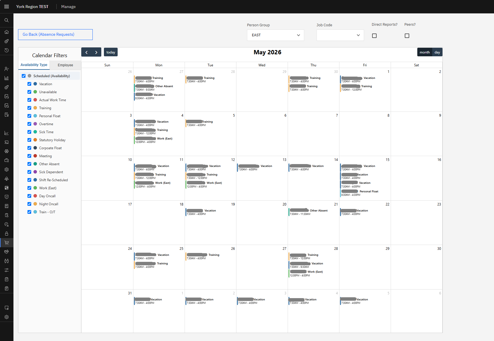

## IBM Maximo / MAS Enhanced Calendar JSP Component

#### By: Andrew Raisbeck

The MAS Calendar control is built on the FullCalendar v6 JavaScript
engine. FullCalendar is released under the MIT licence (see
https://fullcalendar.io/license). You do NOT need a paid license for
the features used here.

Custom build
------------

If you prefer a hand-built bundle, the only v6 plugins required are:

    @fullcalendar/core
    @fullcalendar/daygrid
    @fullcalendar/timegrid
    @fullcalendar/interaction

You would then need to add the lib/libs under applications/maximo/maximouiweb/webclient/lib/fullcalendar/*.

### B. Deploy zipped applications folder as customization archive (IBM MAS)

- Using 7-zip or **gasp** the WIndows shell abomination, zip the applications folder as-is. It's already in the right format for a MAS customization archive. 
- Use a local file server, a public git repo, or similar to host the archive for download.
- Open up IBM MAS, and:
  1. In MAS suite menu, click Administration -> Workspace.
  2. Click on the manage workspace.
  3. Actions -> Update Configuration.
  4. Customization.
  5. Ensure a row exists for this customization archive - adding if needed
     ** if the row already exists, change the label. Incrementing a version number works well.

Wait for OpenShift to rebuild all the pods with your new custom component included in them, and done!

### C. Rapidly develop/test changes.

Once you've deployed the archive the first time, and the properties.jar has been built with the custom control-registry extensions added to it, you can hot-swap in changes to your control without restarting or rebuilding any pods. Using the oc CLI tool, you can dynamically modify the js, jsp, and css as needed.

I have noticed the JSP changes are instant, but for the JS (and likely CSS), the browser will cache and you'll need to clear temp files each time you mod anything in this way.

## SUMMARY OF USE:

Other than being an example, this calendar control is a legitimately useful control to use in Maximo/Manage! Anywhere you would want to display stuff in a calendar (events, workorders, etc.), you can do it with this.

Below are detailed descriptions of each Application XML property and what they are used for. Most of them are to be assigned attributes to use from each record.

### Populating the calendar with event objects

Below are the different ways to populate a set of Mbos as events on the calendar:

-- Method 1: Simple start date/time and end date/time for each event:

Uses:
    startattribute  - event start date/time
    endattribute    - event end date/time

-- Method 2: Work Date + Plus Start and End Time attributes (Same as MODAVAIL table):

Uses:
    workdateattribute   - Event date (no time)
    starttimeattribute  - Event start time (no date)
    endtimeattribute    - Event end time (no date)

-- Method 3: date range + separate start/end time attributes:

Uses:
    startdaterangeattribute - Start of date range (one event per day in range - inclusive)
    enddaterangeattribute - End of date range (**see above)
    starttimeattribute  - Event start time (no date)
    endtimeattribute    - Event end time (no date)

#### Other Event Attributes

titleattribute - Event title.
descattribute - Secondary event text.

### Calendar Data Filters

The control includes optional primary and secondary filtering mechanisms which can be used to show/hide events on the calendar by checking/unchecking boxes. You can also include a "group-by" attribute for both the primary and secondary calendar filter - which will organize you're filters in a 2-level hierarchy by the groupby attribute, and allow you to toggle the entire group on/off as needed.

The primary and secondary filter properties are identical, so only the primary filter columns will be listed below to avoid repetition:

primaryfiltervalue - attribute value to use for the primary calendar filter. ie. PERSONID
primaryfilterdisplay - attribute (works with relationship syntax as well) to use for displaying the primary filter values. ie. PERSON.DISPLAYNAME
primarygroupbyvalue - attribute which is used to group the filter values and is itself a filter as well. ie. PERSONGROUP

The same options exist for secondary filters.

### Removing duplicates

If you have a situation where you have many of a specific type of event on the same day, and you really just need to display that that AT LEAST ONE of that event type exists in the calendar (you want to group events by specific attributes and remove duplicates), use the below property:

duplicatecolumns - a comma or semi-colon delimited list of attributes for which calendar events will be grouped and duplicates removed.

### Misc. Calendar Display Properties

height - defines how large the calendar will be. A large height will expand in width as well if possible.
defaultview - the default view to open to (month is standard).
showlegend - whether to show the legend or not (the legend is also the filtering mechanism).
readonly - can be used to toggle on/off edit events or abilities in the calendar (currently does nothing!).

## FUTURE WORK

Future planned enhancements or ideas:

1. Click handling for events on calendar - current WIP.
2. New properties to dynamically set mxevent data to be sent on click (ie. MXEVENT_VALUE -> onclick -> sendEvent(calendarcontrol_id, null, MXEVENT_VALUE))
3. Better integration so that OOTB controls can be related to this calendar, and will update based on the current selected event.
